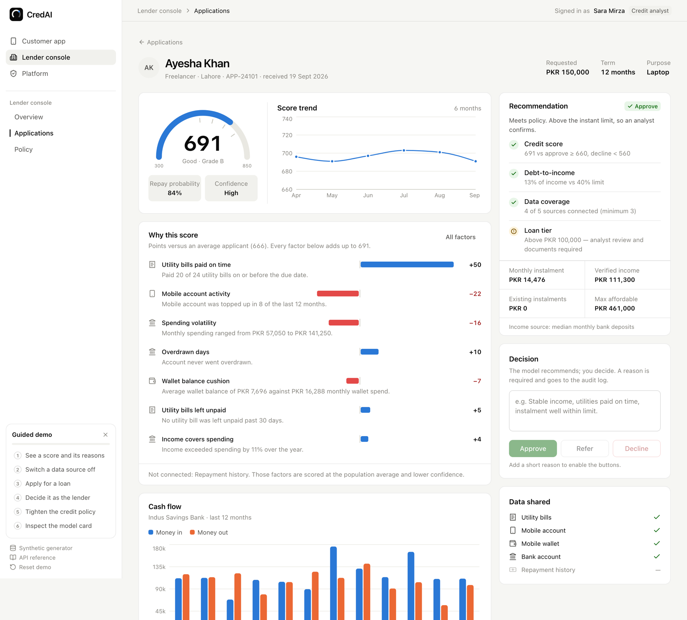
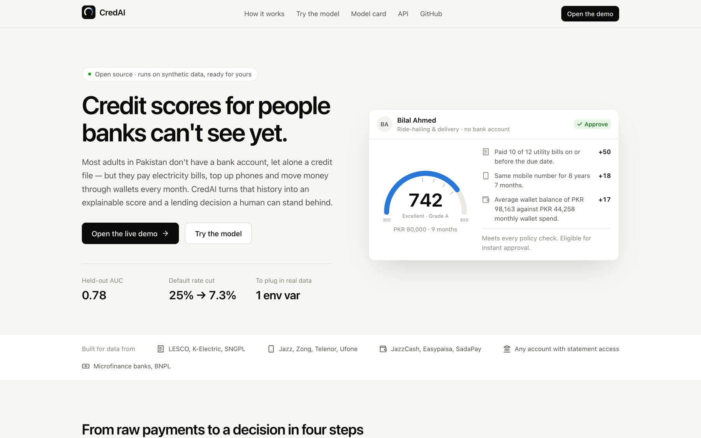
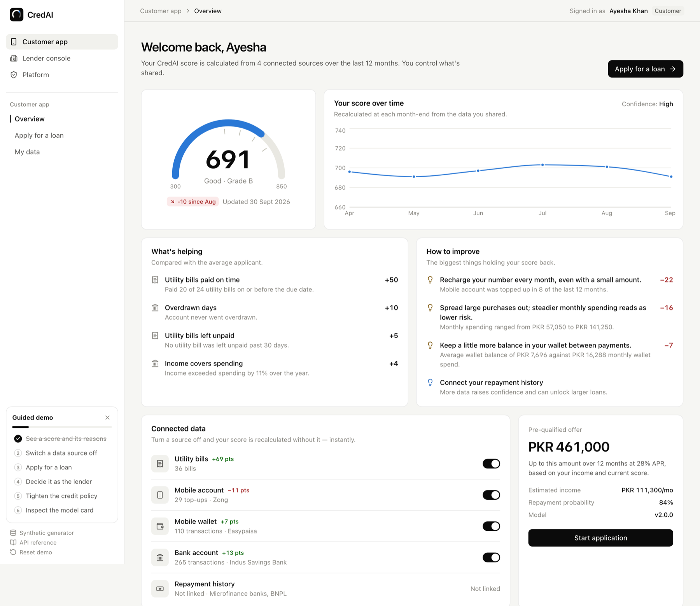
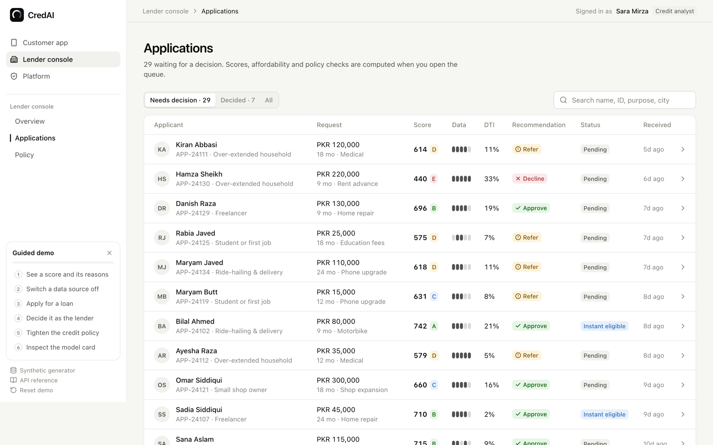
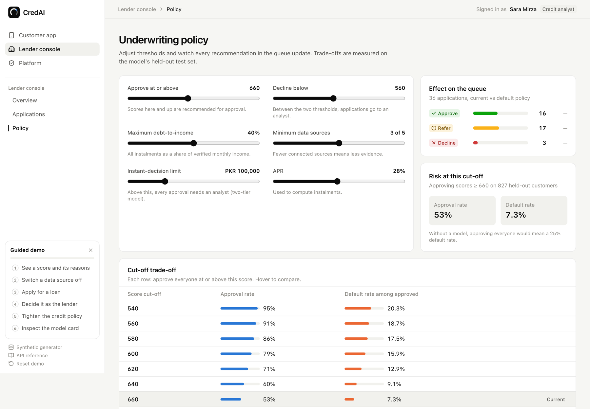
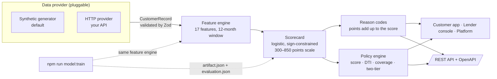
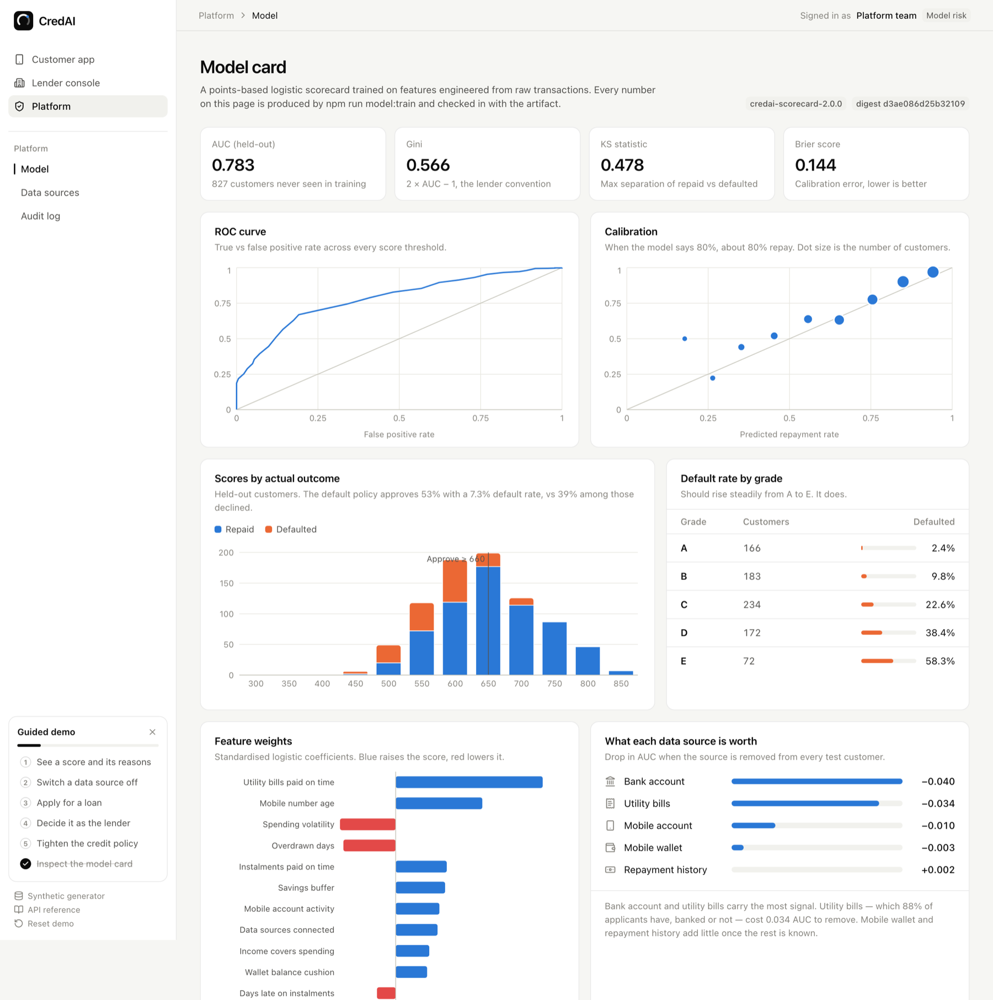

<div align="center">

# CredAI

**Explainable credit scoring for people without a credit file.**

CredAI turns utility bills, mobile top-ups, wallet and bank activity into a credit score, plain-language reason codes and an underwriting decision. A lender console, customer app and model-risk workspace all sit on one engine. It runs on a realistic synthetic population out of the box, and switches to your data source with one environment variable.

[Live demo](#live-demo) · [Try the model](#how-it-works) · [API](#api) · [Model card](#the-model) · [Plug in real data](#plug-in-real-data)

[](https://github.com/M-Nabeegh/cred-ai-giki/actions/workflows/ci.yml)


<picture>
  <source media="(prefers-color-scheme: dark)" srcset="docs/screenshots/review-dark.png" />
  
</picture>

</div>

---

## Why

Roughly four in five adults in Pakistan don't have a formal financial account ([World Bank Global Findex 2021](https://www.worldbank.org/en/publication/globalfindex)), so they're invisible to lenders. Yet most of them pay electricity bills, recharge a phone number and move money through JazzCash or Easypaisa every month. That behaviour says a lot about how someone handles obligations. CredAI makes it usable:

- **For lenders:** a score with reasons you can defend, affordability checks, and a policy you control. The model recommends and an analyst decides.
- **For customers:** a score you can actually understand, a list of what would improve it, and full control over which data is shared.
- **For risk teams:** a model card with discrimination, calibration and fairness metrics, plus an audit trail of every decision.

## Live demo

Open the app and choose **Open the demo**. There's no sign-up. A guided checklist walks through the full loop in about three minutes:

1. **As Ayesha (customer):** see her score and its reasons, switch her bank account off and watch the score and loan offer recalculate.
2. **Apply** for PKR 150,000 over 12 months, with live instalment and affordability.
3. **As Sara (credit analyst):** the application appears in the queue with a full underwriting view. Approve, refer or decline with a recorded reason.
4. **Tighten the credit policy:** every recommendation in the queue updates, alongside the approval-rate vs default-rate trade-off.
5. **As the platform team:** inspect the model card, the fairness audit, the data-source health check, and the audit log of everything you just did.

Demo actions are stored in your browser only. Nothing is sent anywhere.

| Landing page | Customer app |
| --- | --- |
|  |  |
| **Application queue** | **Underwriting policy** |
|  |  |

## How it works



- **One raw-data contract.** A `CustomerRecord` holds raw history per source: bills with due and paid dates, top-ups, wallet and bank transactions with running balances, loan instalments. Every source is optional and consent-gated.
- **One feature engine, used everywhere.** [`src/lib/core/features.ts`](src/lib/core/features.ts) computes on-time ratios, income regularity, overdrawn days, savings buffer and more. Training and live scoring run the same code, so there's no train/serve skew.
- **A scorecard that explains itself.** A logistic model scaled to 300–850 with a 50-point PDO. Each feature contributes `factor × weight × z-score` points, so the reason codes sum **exactly** to the score, which a test enforces. Every reason is a fact about the customer's own data ("Paid 20 of 24 utility bills on or before the due date").
- **A policy engine with a human in the loop.** It checks score bands, debt-to-income on verified income, data coverage and loan tier. Loans up to PKR 100k can be decided instantly; larger ones always go to an analyst, following the two-tier model from the original proposal.

## Plug in real data

The synthetic generator implements the same interface as a real integration. To use your own data, expose three read endpoints that return the [data contract](src/lib/core/schema.ts):

```
GET /customers        → CustomerRecord[]   (or { data: CustomerRecord[] })
GET /customers/{id}   → CustomerRecord
GET /applications     → Application[]      (optional — 404 means none)
```

Then set:

```bash
CREDAI_DATA_PROVIDER=http
CREDAI_DATA_API_URL=https://data.your-bank.example/v1
CREDAI_DATA_API_KEY=...          # sent as a Bearer token
```

Every page, the API and the health check switch over with no code changes. Records that fail validation are rejected and counted, never silently coerced. To see it work locally, run the bundled **mock partner API**, which serves a different population over HTTP:

```bash
npm run mock:api
CREDAI_DATA_PROVIDER=http CREDAI_DATA_API_URL=http://localhost:4010 CREDAI_DATA_API_KEY=dev-key npm run dev
```

## The model



Trained by `npm run model:train` on 4,000 simulated customers (1.38M raw records), evaluated on a held-out 20%:

| Metric | Value | |
| --- | --- | --- |
| AUC | **0.783** | Gini 0.566, KS 0.478 |
| Brier score | 0.144 | Well calibrated (see calibration plot) |
| Default rate if everyone is approved | 25.4% | Base rate |
| Default rate among approvals at score ≥ 660 | **7.3%** | while approving 53% of applicants |
| Default rate by grade A → E | 2.4% · 9.8% · 22.6% · 38.4% · 58.3% | monotonic |

**How the synthetic data avoids grading its own homework.** Each simulated customer has hidden traits: payment discipline, income stability, liquidity and tenure. Those traits generate *raw events*: payroll or gig payouts, rent and spending, bills paid early or late, phone recharges, and wallet transfers that bounce when the balance is short. The repayment outcome is drawn separately from the traits. The model only ever sees features computed from the events, exactly as it would from a real API, so the metrics reflect a genuine noisy learning problem rather than a circular one.

**Scorecard practices built in:**

- **Sign constraints.** Projected gradient descent keeps every weight in its business direction, so more failed payments can never raise a score.
- **Missing-data handling.** Unshared sources are imputed at the population mean, contribute 0 points, lower confidence and reduce the `data_coverage` feature.
- **Fairness audit.** A held-back region attribute (never a model input) is used to report approval rate, TPR, FPR and adverse-impact ratio per group against the four-fifths rule.
- **Source ablation.** Measures how much AUC each data source contributes.

> Metrics describe performance on simulated behaviour. Before lending, retrain and validate on real repayment outcomes. The pipeline is the same; only the generator is replaced.

## API

All endpoints are documented in the app at `/developers`, and as OpenAPI 3.1 at `/api/v1/openapi.json`, generated from the same Zod schemas that validate requests.

| Method | Path | |
| --- | --- | --- |
| `POST` | `/api/v1/score` | Stateless: score a raw `CustomerRecord`, optionally with a loan and policy overrides |
| `GET` | `/api/v1/customers` | Customers from the configured provider, with scores |
| `GET` | `/api/v1/customers/{id}?amount=&tenureMonths=` | Full score report and policy decision |
| `GET` | `/api/v1/model` | Artifact, held-out metrics, fairness audit |
| `GET` | `/api/v1/health` | Provider connectivity, validated record count, latency (503 when down) |

```bash
curl -X POST http://localhost:3000/api/v1/score \
  -H 'content-type: application/json' \
  -d @examples/customer-record.json
```

Invalid input returns `422` with the exact path, e.g. `customer.utility.bills.0.dueDate: Expected an ISO-8601 date`.

## Run it locally

Requires Node.js 20+.

```bash
npm install
npm run dev              # http://localhost:3000
npm run check            # lint + typecheck + tests
npm run model:train      # regenerate the population, retrain, rewrite artifact + evaluation
npm run build
```

Training is deterministic: the same seed produces the same data, the same weights and the same artifact digest.

## Project structure

```
src/
  lib/
    core/          schema.ts (data contract) · features.ts · scorecard.ts · policy.ts · stats.ts
    synthetic/     generator.ts (agent-style simulation) · portfolio.ts (demo population)
    model/         train.ts · artifact.json · evaluation.json (generated)
    data/          provider.ts · synthetic-provider.ts · http-provider.ts · service.ts
    demo/          store.ts (browser-local demo workflow state)
  app/
    page.tsx       landing page with an in-browser model sandbox
    (app)/         customer · lender · platform workspaces
    api/v1/        REST endpoints
    developers/    API reference
  components/      UI kit, charts, workspace views
scripts/           train.ts · mock-bank-api.ts · export-sample.ts
tests/             feature engine, scorecard additivity, policy, HTTP provider
examples/          customer-record.json (valid request body)
```

## Tech

Next.js 16 (App Router, server components), React 19, TypeScript (strict), Tailwind CSS 4, Zod 4, Recharts, Vitest. No ML framework: the logistic regression, metrics and fairness audit are written from scratch in TypeScript, about 300 lines, and readable end to end.

## Not production yet

This is a portfolio and research project. Before real lending it would need real authentication and authorisation in place of the demo seats, a database for decisions and the audit log (they currently live in the browser), encrypted storage and data-retention rules, model validation on real outcomes with ongoing monitoring, and legal review against SBP and data-protection requirements.

## Background

CredAI started as a software-engineering course project at GIKI (Muhammad Nabeegh, Abdul Ahad Ali Khan, Ahmed Abu Bakar Riaz). The original proposal is in [`docs/`](docs). Version 2 rebuilt it around a real raw-data pipeline, a pluggable data layer and a production-style lender workflow. The [audit](docs/AUDIT.md) explains what changed and why.

## License

MIT. See [LICENSE](LICENSE).
